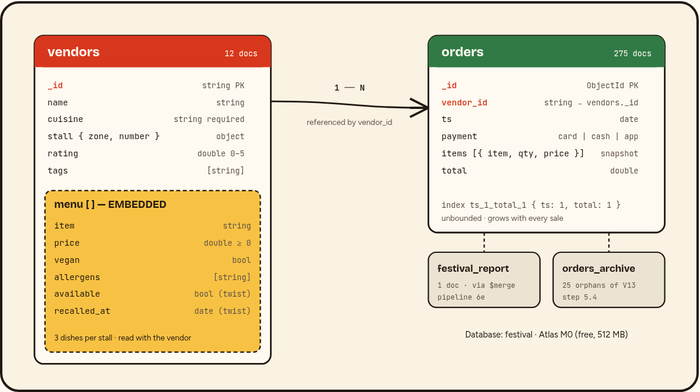

# Street Food Festival — MongoDB Atlas back end

**Course project · Team:** [Member 1], [Member 2], [Member 3] · **Database:** `festival` on a free Atlas M0 cluster · **Tools:** MongoDB 8.x, mongosh 2.x, Atlas Data Explorer & Aggregation Pipeline Builder

## 1. Goal

The organisers of a three-day street food festival (20–22 June 2026) want to know **which stalls earn most**, **when the queues peak**, and **how fast they can warn visitors about an allergen**. We built a two-collection model on one free Atlas cluster, loaded 13 vendors and 300 orders, answered the questions with five aggregation pipelines, tuned one pipeline with a compound index, protected the data with `$jsonSchema` validation, and solved a sesame-recall twist. Every script in `scripts/` runs from an empty database (`run_all.sh` or `all_queries.js`).

## 2. Data model



**Why the menu is embedded but orders are not.** The menu is embedded because it is small and bounded (three dishes per stall), it is always read together with its vendor and it changes rarely, so one read returns the stall with every price and allergen. Orders are stored separately with a `vendor_id` reference because they are unbounded — every sale adds one — and embedding them would grow each vendor document towards the 16 MB limit and turn every sale into a rewrite of that vendor. As their own collection, orders can be indexed by time and aggregated across all vendors at once, which is exactly what the revenue, queue-peak and payment questions need.

### Design decisions

| Decision | Reason |
|---|---|
| Readable string `_id` for vendors (`"V01"`) | Short, stable reference used in every order; easy to type in the live demo. |
| Order items keep a **snapshot** of `item` and `price` | A later price change (Step 5.3, +10 % Georgian) must not rewrite money already taken. |
| `items` is an array even with one dish | Real orders contain several dishes; pipeline 6c already `$unwind`s it. |
| `stall: { zone, number }` sub-document | Zone queries (`"stall.zone": "B"`) and sorting by location. |
| `allergens` as an array of strings | Multikey match `{ "menu.allergens": "sesame" }` finds a dish in one condition. |
| `available` flag added only when needed | Missing = available; the recall sets `false`, so no migration of old data. |
| Seeded random generator in Step 4 | Same 300 orders on every run, so our numbers can be checked and re-produced on Atlas. |
| Orphans moved to `orders_archive` | MongoDB has no cascade delete; we keep the money history but out of live reports. |
| Report built with `$merge` on a fixed `_id` | Re-running refreshes one report document instead of creating duplicates. |

**Size check (fits one free cluster).** Measured with `db.stats()`: a vendor averages 456 bytes and an order 150 bytes; the whole database is 52 KB of data. The 512 MB M0 limit would hold roughly 3 million orders — about 10 000 festivals of this size.

## 3. Steps and results

| Step | What we did | Result |
|---|---|---|
| 1 | Created database `festival`, collections `vendors`, `orders` | `[ 'orders', 'vendors' ]` |
| 3 | Inserted 13 vendors by hand, 9 cuisines, zones A/B/C | 13 vendors (4 A, 5 B, 4 C) |
| 4 | Loop from the brief, 300 orders | 300 orders, 20 Jun 12:00 → 22 Jun 22:57 |
| 5.1 | Vegan dishes under 7 EUR (`$unwind` + `$match`) | 12 dishes, cheapest Churchkhela & Sauerkraut salad 3.50 |
| 5.2 | Zone B and `rating > 4.3` | 4 vendors; Supra Grill (exactly 4.3) correctly excluded |
| 5.3 | +10 % on every Georgian price (update pipeline + `$round`) | 2 vendors, 6 dishes, e.g. 9.00 → 9.90, 10.50 → 11.55 |
| 5.4 | Deleted vendor V13 | 25 orders orphaned (348.50 EUR) → archived; 12 vendors, 275 orders remain |
| 6a–6e | Five pipelines | see section 4 |
| 7 | Index `{ ts: 1, total: 1 }` | `totalDocsExamined` 275 → **0** |
| 8 | `$jsonSchema` on vendors | negative price and missing cuisine both rejected |
| Twist | `updateMany` + `arrayFilters` | 7 dishes at 3 stalls recalled, 9 safe stalls |

Screenshots of every step with its result are in `screenshots/`.

## 4. Answers to the analysis questions

**Which stalls earn most? (6a)** Sushi Wave leads with **448.50 EUR** from 29 orders, ahead of Napoli Slice (389.00) and Tbilisi Fire (379.00). Rīgas Kūpinātava earns least (183.50). Total festival revenue: **3 782.00 EUR**, 275 orders, average order 13.75 EUR, 535 portions.

**When do the queues peak? (6b)** 20 June **12:00–13:00** (11 orders), 21 June **15:00–16:00** (13 orders), 22 June **14:00–15:00** (16 orders, 213.50 EUR). Saturday is the busiest day overall (98 orders, 1 382.50 EUR). Organisers should add staff at the lunch/early-afternoon slot.

**What sells best per cuisine? (6c)** Chicken quesadilla (Mexican, 26 portions) and Adjarian khachapuri (Georgian, 25) top the list; Avocado maki (Japanese, 21), Varenyky (Ukrainian, 22), Margherita (Italian, 20), Hummus plate (Lebanese, 19), Potato pancakes (Latvian, 19), Chana masala (Indian, 17).

**How do visitors pay? (6d)** Card 35.3 % of orders (35.0 % of revenue), app 32.4 % (31.8 %), cash 32.4 % (33.1 %). Cash is still one third — stalls must keep change.

**Festival report (6e).** One `$facet` pipeline computes totals, per-day figures, top-3 vendors and the payment split and writes them with `$merge` into `festival_report` (`_id: "festival-2026"`).

**What happens to orders when a vendor is deleted? (5.4)** Nothing — MongoDB has no foreign keys or cascade delete. The 25 orders of V13 stayed and pointed to a vendor that no longer exists; a `$lookup` returns an empty array for them. We found them with `$lookup` + `$match: { v: { $size: 0 } }`, copied them into `orders_archive` with `$merge`, then removed them from `orders`. Alternatives would be a soft delete (`active: false`) or a transaction that deletes both.

**How fast can we warn about an allergen? (Twist)** One `updateMany` with `arrayFilters` changes only the matching array elements in all vendors in a single command; the safe-stall query is a single `find` on the multikey field. On our data both run in milliseconds.

## 5. Index and explain (Step 7)

Pipeline 6b filters on `ts` and needs only `ts` (for `$hour`, `$dayOfMonth`) and `total` (revenue). The compound index `{ ts: 1, total: 1 }` serves the `$match` range **and** contains every field the pipeline reads, so the plan becomes a **covered query**: the server never opens a document.

| Run | Winning plan | totalDocsExamined | totalKeysExamined |
|---|---|---|---|
| Before (no index) | `GROUP ← COLLSCAN` | **275** | 0 |
| After `{ ts: 1, total: 1 }` | `GROUP ← PROJECTION_COVERED ← IXSCAN` | **0** | 275 |

`ts` comes first because it carries the range filter (Equality–Sort–Range rule: the range field is the only filter here); `total` is added only to make the query covered. With 275 documents the time is 1–3 ms either way; the gain is in documents read, which grows linearly with real festival volumes.

## 6. Validation (Step 8)

`collMod` adds a `$jsonSchema` with `required: [_id, name, cuisine, stall, menu]` and, for every menu item, `price: { minimum: 0 }`. `validationLevel: "strict"`, `validationAction: "error"`. All 12 existing vendors pass. An insert with `price: -2.5` is rejected ("Document failed validation", `itemIndex: 0`, `minimum: 0`) and an insert without `cuisine` is rejected (`missingProperties: ['cuisine']`). A valid vendor is accepted. Numbers are allowed as `double`, `int` or `decimal` because the shell stores `6.5` as a double and `4` as an int-like double.

## 7. Twist — sesame recall at 19:00

```js
db.vendors.updateMany(
  { "menu.allergens": "sesame" },
  { $set: { "menu.$[dish].available": false, "menu.$[dish].recalled_at": ISODate("2026-06-22T19:00:00Z") } },
  { arrayFilters: [ { "dish.allergens": "sesame" } ] })
// matchedCount 3, modifiedCount 3  -> 7 dishes at Tokyo Ramen Bar, Sushi Wave, Beirut Bites
db.vendors.find({ "menu.allergens": { $ne: "sesame" } }, { name: 1, stall: 1 })
```

**Safe stalls (9):** Taco Loco A1, Napoli Slice A2, Pelmeņi Express A3, Rīgas Kūpinātava A5, Tbilisi Fire B1, Bombay Street B3, Supra Grill B4, Borsch & Co C1, El Fuego C5. We treat a stall as safe only if **no** dish on its menu contains sesame, because recalled ingredients may still be in the kitchen (cross-contamination). Tokyo Ramen Bar (Edamame) and Sushi Wave (Mochi) still sell sesame-free dishes but are listed as "avoid". Bonus: 11 orders of recalled dishes were sold after 19:00 — the visitors to contact.

## 8. Tools and AI use

We used MongoDB Atlas (free M0 cluster, Data Explorer shell, Aggregation Pipeline Builder) and mongosh. An AI assistant (Lovable) helped draft the vendor data, the script structure, the screenshot pages and this report; every query was run by us against a real MongoDB 8 database, and all numbers in this report are copied from the recorded outputs in `outputs/`. Each team member re-wrote and can explain the queries they present; we checked the AI's suggestions against the MongoDB documentation (`$merge`, `arrayFilters`, explain output) and corrected them where needed, for example rounding prices after the 10 % rise and storing a price snapshot in each order.
